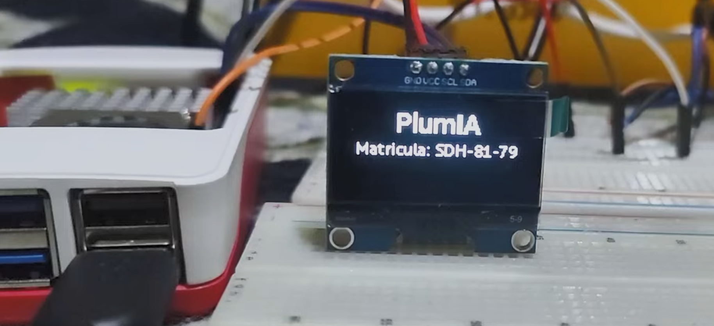
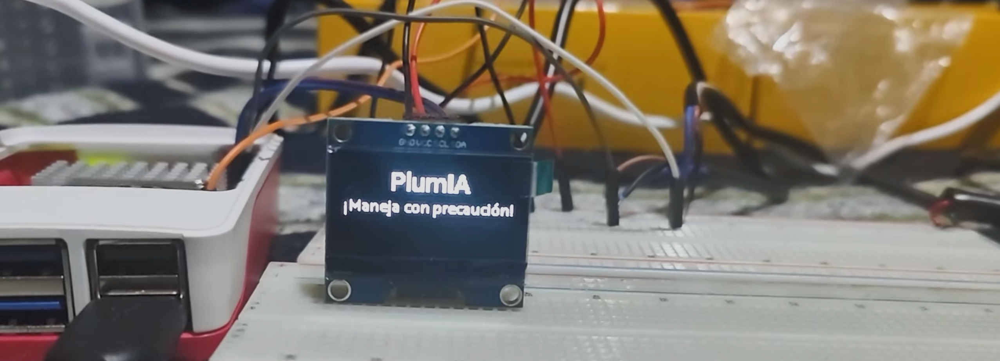
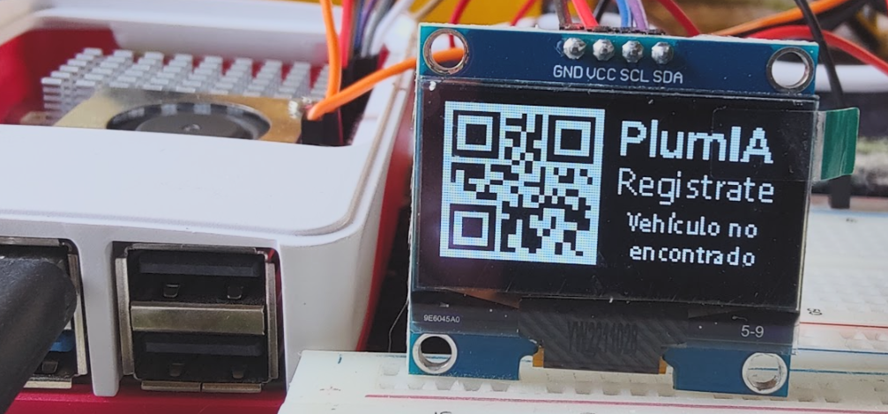

# PlumIA · Edge Device

**Intelligent parking access control powered by computer vision and IoT.**

<p align="center">
  
</p>

`plumia-rasp` is the edge computing module of **PlumIA**, a smart parking gate system for shopping malls developed as my capstone graduation project for an engineering degree. It runs on a Raspberry Pi installed at the parking entrance and combines an **Automatic License Plate Recognition (ALPR)** pipeline, based on deep learning and **Digital Image Processing (DIP)**, with real-time control of the barrier, vehicle sensors and an on-site display.

PlumIA replaces the traditional paper ticket with a fully contactless experience. The vehicle is identified by its license plate, a parking spot is assigned automatically and the driver receives everything they need on their phone through a conversational assistant: a personalized welcome, the hourly rate, the exact location of their spot and, on departure, a breakdown of the total cost of their stay. The assistant runs on Telegram, and its messaging layer is designed to support additional channels such as WhatsApp.

## Highlights

- **On-device ALPR.** License plate detection and recognition run entirely on the Raspberry Pi, without relying on external vision services.
- **Deep learning detection.** A YOLOv8 object detection model, trained specifically for license plates, locates the plate in each video frame.
- **Digital image processing pipeline.** Region-of-interest extraction, color space conversion and adaptive binarization with Otsu's method prepare the plate for character recognition.
- **Optical character recognition.** EasyOCR, a neural network based OCR engine, extracts the plate characters.
- **Domain-aware error correction.** A positional validation algorithm corrects common OCR confusions using the structure of Mexican license plates.
- **Physical access control.** Servo-driven barrier and dual vehicle sensors manage the full entry cycle.
- **On-site OLED display.** Shows real-time parking availability, confirms the recognized plate and generates a QR code so unregistered drivers can sign up instantly.
- **Cloud integration.** REST communication with the PlumIA backend registers each visit and triggers real-time notifications to the driver.

## System architecture

PlumIA is built as a distributed system made up of three components:

| Repository | Layer | Responsibility |
| --- | --- | --- |
| [plumia-rasp](https://github.com/Alejandro095/plumia-rasp) | Edge device | Computer vision, barrier control, sensors and on-site display (this repository). |
| [plumia-bot](https://github.com/Alejandro095/plumia-bot) | Backend | REST API and conversational assistant. Manages users, vehicles, visits and parking spots, and notifies drivers in real time. |
| [plumia-admin](https://github.com/Alejandro095/plumia-admin) | Management | Web dashboard for mall administrators. Manages parking spots, rates and the visitor log. |

```
┌──────────────────────┐   license plate   ┌──────────────────────┐   notifications   ┌──────────────┐
│     Edge device      │ ────────────────▶ │      plumia-bot      │ ────────────────▶ │    Driver    │
│    (Raspberry Pi)    │                   │  REST API + chatbot  │                   │  (Telegram)  │
│  ALPR · servo ·      │ ◀──────────────── │                      │                   └──────────────┘
│  sensors · OLED      │  visit / spots    └──────────┬───────────┘
└──────────────────────┘                              │
                                                      ▼
                                           ┌──────────────────────┐                   ┌──────────────┐
                                           │      PostgreSQL      │ ◀──────────────── │ plumia-admin │
                                           │       database       │                   │   (Astro)    │
                                           └──────────────────────┘                   └──────────────┘
```

## License plate recognition pipeline

The core of the device is a multi-stage ALPR pipeline that turns a raw camera frame into a validated license plate string:

```
┌─────────┐   ┌──────────────┐   ┌──────────────┐   ┌──────────────┐   ┌──────────────┐   ┌──────────────┐
│ Capture │ ─▶│  Detection   │ ─▶│ ROI cropping │ ─▶│ Pre-process  │ ─▶│     OCR      │ ─▶│  Validation  │
│ (webcam)│   │   (YOLOv8)   │   │              │   │ gray + Otsu  │   │  (EasyOCR)   │   │ & correction │
└─────────┘   └──────────────┘   └──────────────┘   └──────────────┘   └──────────────┘   └──────────────┘
```

| Stage | Technique | Purpose |
| --- | --- | --- |
| 1. Image acquisition | OpenCV video capture | Captures frames from the gate camera while a vehicle is present. |
| 2. Plate detection | YOLOv8 convolutional neural network (`license_plate_detector.pt`) | Locates the license plate and returns its bounding box and confidence score. |
| 3. Region of interest | Bounding box cropping | Isolates the plate from the rest of the scene, reducing noise and processing cost. |
| 4. Color space conversion | BGR → grayscale | Removes color information that is irrelevant to character recognition. |
| 5. Segmentation | Otsu's automatic thresholding (inverted binary) | Separates characters from the background by computing the optimal threshold from the image histogram, adapting to different lighting conditions. |
| 6. Character recognition | EasyOCR (deep learning OCR) | Converts the binarized plate into text. |
| 7. Post-processing | Positional validation and correction algorithm | Validates the plate format and fixes OCR confusions. |

### Validation and correction algorithm

OCR engines frequently confuse visually similar characters such as `O`/`0` or `S`/`5`. Because each position of a Mexican license plate is known to hold either a letter or a digit, the algorithm checks every character against its expected type and remaps it when needed:

| Read as | Expected letter | Expected digit |
| --- | --- | --- |
| `0` / `O` | `O` | `0` |
| `1` / `I` | `I` | `1` |
| `3` / `J` | `J` | `3` |
| `4` / `A` | `A` | `4` |
| `5` / `S` | `S` | `5` |
| `6` / `G` | `G` | `6` |

Readings that cannot be mapped to a valid structure are discarded, and the pipeline keeps sampling frames until a reliable result is obtained. The supported formats are:

```
ABC-123-A
ABC-12-34
```

## Access control flow

1. **Standby.** The display cycles between a welcome screen, live parking availability retrieved from the backend and a safe-driving message.
2. **Vehicle detection.** The entry sensor triggers the recognition process and the display switches to an animated loading screen.
3. **Recognition.** The ALPR pipeline analyzes frames from the camera until it obtains a valid license plate.
4. **Visit registration.** The plate is sent to the backend, which verifies the vehicle, assigns an available parking spot and notifies the driver with the rate and the location of their spot.
5. **Access granted.** The display confirms the plate and the servo raises the barrier.
6. **Driver onboarding.** If the vehicle is not yet registered, the display generates a QR code that takes the driver directly to the assistant, where they can sign up in seconds.
7. **Gate closing.** Once the exit sensor confirms the vehicle has passed, the barrier is lowered and the device returns to standby.

## Hardware

| Component | Function |
| --- | --- |
| Raspberry Pi | Edge computing unit |
| USB camera | Image acquisition for the ALPR pipeline |
| Servo motor | Barrier actuation |
| Entry sensor | Vehicle arrival detection |
| Exit sensor | Vehicle passage confirmation |
| SH1106 OLED display (128×64, I²C) | Human-machine interface |

### Pin mapping

| GPIO | Connected to |
| --- | --- |
| 26 | Servo signal (PWM) |
| 15 | Entry sensor |
| 14 | Exit sensor |
| 2 (SDA) / 3 (SCL) | OLED display, I²C address `0x3C` |

## On-site OLED display

The gate includes an SH1106 OLED display that acts as the human-machine interface between the system and the driver. It keeps drivers informed before they enter, guides them through the access process and allows new users to register on the spot:

- **Real-time parking availability.** While idle, the display shows how many spots are free out of the total capacity of the mall. The data is queried periodically from the backend, so drivers know whether there is room before entering. When the parking lot is full, it shows a "no spots available" message instead.
- **License plate confirmation.** Once the ALPR pipeline recognizes the plate and the visit is registered, the plate is displayed as confirmation while the barrier opens.
- **QR code registration.** If the vehicle is not registered, the device generates a QR code directly on the screen. Scanning it opens the PlumIA assistant, where the driver can create an account and register their vehicle in seconds, without staff or extra apps.
- **Status and safety messages.** A welcome screen, an animated loading indicator during recognition and safe-driving reminders complete the cycle.

<table>
  <tr>
    <td align="center"><br><sub>Real-time parking availability</sub></td>
    <td align="center"><br><sub>Recognized license plate</sub></td>
  </tr>
  <tr>
    <td align="center"><br><sub>Standby message</sub></td>
    <td align="center"><br><sub>QR code for driver registration</sub></td>
  </tr>
</table>

| Screen | Displayed when |
| --- | --- |
| Welcome | Standby |
| Available spots (`free / total`) | Standby, refreshed from the backend |
| No spots available | Standby, when the parking lot is full |
| Loading animation | During license plate recognition |
| Recognized plate | Access granted |
| Registration QR code | Vehicle not registered |

All screens are rendered in real time with Pillow, and the QR code is generated on the device. The loading animation runs on a dedicated thread, so the interface stays responsive while the recognition model is processing.

## Tech stack

**Edge device (this repository)**
- Python 3.11 on Raspberry Pi OS
- [Ultralytics YOLOv8](https://github.com/ultralytics/ultralytics) – deep learning object detection
- [OpenCV](https://opencv.org/) – image acquisition and digital image processing
- [EasyOCR](https://github.com/JaidedAI/EasyOCR) – optical character recognition
- NumPy · SciPy · pandas – numerical computing
- [gpiozero](https://gpiozero.readthedocs.io/) – servo and sensor control
- [luma.oled](https://github.com/rm-hull/luma.oled) + Pillow – display rendering
- qrcode – QR code generation
- Requests – REST communication with the backend

**Backend**
- Node.js + TypeScript
- Express – REST API
- Telegraf – Telegram bot framework
- PostgreSQL (Vercel Postgres)
- Joi – request validation

**Management dashboard**
- Astro + TypeScript
- Tailwind CSS + Flowbite
- JWT and bcrypt authentication
- Zod – schema validation

## Project structure

```
src/
├── main.py                     # Access control flow, sensors and display cycle
├── alpr/
│   ├── main.py                 # Image acquisition and YOLOv8 plate detection
│   ├── utils.py                # OCR, validation and correction algorithm
│   └── models/
│       └── license_plate_detector.pt
├── lib/
│   ├── servo.py                # Barrier control
│   ├── requests.py             # Backend client
│   └── oled/
│       ├── main.py             # Screens, loading animation and QR generation
│       └── utils/text.py
└── fonts/
```

## Getting started

Requirements: a Raspberry Pi with Raspberry Pi OS, Python 3.11 and the I²C interface enabled (`sudo raspi-config` → *Interface Options* → *I2C*).

1. Clone the repository:

   ```bash
   git clone https://github.com/Alejandro095/plumia-rasp.git
   cd plumia-rasp
   ```

2. Create a virtual environment with access to the system packages (so `gpiozero` from Raspberry Pi OS is available) and install the dependencies:

   ```bash
   python -m venv --system-site-packages plumia
   source plumia/bin/activate
   pip install -r requirements.txt
   ```

3. Set the mall that the gate belongs to. The ID is defined in `src/lib/requests.py` and in the visit request inside `src/main.py`:

   ```python
   MALL_ID = '1'
   ```

4. Run the program from the root of the repository:

   ```bash
   python src/main.py
   ```

## Author

**Javier Alejandro Monsivais Tovar**
